# RAVEN — Responsible Audio Verification & Evidence Navigator

[](https://www.python.org/)
[](https://fastapi.tiangolo.com/)
[](https://nextjs.org/)
[](https://tailwindcss.com/)
[](https://www.gnani.ai/)

> **"Hear the signal. Investigate the claim."**  
> Developed for the **Great Indian AI Internship Challenge 2026** (Deadline: November 10, 2026).

---

## 🎯 Executive Overview

**RAVEN** (Responsible Audio Verification & Evidence Navigator) is a production-oriented multilingual voice intelligence and evidence investigation platform. Built for researchers, journalists, civic teams, and compliance analysts, RAVEN turns recorded multilingual audio into searchable transcripts, extracts checkable factual claims, evaluates epistemic uncertainty, corroborates assertions against primary public records, and generates human-reviewed executive dossiers.

### Core Philosophy
* **Zero Automatic Truth Hallucinations:** No AI model has the authority to arbitrarily declare a claim true or false. Spoken claims require corroboration against verified primary sources (court records, government gazettes, certified laboratory audits).
* **Indic-First Voice Intelligence:** Native support for Indian English, Hindi, Kannada, Tamil, Telugu, Marathi, Gujarati, Bengali, Malayalam, and Punjabi via **Gnani AI Prisma STT**.
* **Audio-Text Synchronization:** Selecting any transcript sentence seeks the audio directly to that exact millisecond.
* **Neural Voice Dossiers:** Synthesize executive summaries into spoken regional briefings with **Gnani AI Timbre TTS**.

---

## 🏛️ System Architecture

```mermaid
flowchart LR
    A[Multilingual Audio Input] --> B[FastAPI Backend]
    B --> C[Gnani Prisma v3.0 STT]
    C --> D[Timestamped Transcript Segments]
    D --> E[Claim Extraction & Uncertainty Engine]
    E --> F[Evidence Workspace & Citations]
    F --> G[Human Analyst Adjudication]
    G --> H[Executive Investigation Dossier]
    H --> I[Gnani Timbre v2.5 TTS Briefing]
```



Detailed design documentation: [`docs/ARCHITECTURE.md`](docs/ARCHITECTURE.md)  
Gnani API integration specifications: [`docs/GNANI_INTEGRATION.md`](docs/GNANI_INTEGRATION.md)  
Features and status checklist: [`docs/CHECKLIST.md`](docs/CHECKLIST.md)  
60-second video demo script: [`docs/DEMO_SCRIPT.md`](docs/DEMO_SCRIPT.md)

---

## 💻 Tech Stack

* **Frontend:** Next.js 14 App Router, TypeScript, Tailwind CSS, Lucide Icons, Zustand, React Hook Form, Framer Motion.
* **Backend:** Python FastAPI, Pydantic v2, SQLAlchemy, SQLite (with PostgreSQL compatibility), Bcrypt, PyJWT, HTTPX.
* **Voice AI Models:**
  * **Gnani Prisma v3.0:** Multilingual speech-to-text with auto Indic language detection.
  * **Gnani Timbre v2.5:** Neural text-to-speech inference with expressive tags.
  * **Gnani Evon 30B MoE:** Open-weight reasoning integration via OpenAI-compatible API or transparent syntactic heuristic fallback.

---

## 🚀 Quick Start (Local Setup)

### 1. Prerequisites
* Node.js 18+ (Tested on v23.6)
* Python 3.10+ (Tested on v3.13)
* Git

### 2. Clone and Setup Environment
```bash
git clone https://github.com/your-username/RAVEN.git
cd RAVEN

# Copy environment example
cp .env.example .env
```

### 3. Start Backend (FastAPI)
```bash
cd apps/api

# Create and activate virtual environment
python -m venv venv
# On Windows:
.\venv\Scripts\activate
# On Linux/macOS:
source venv/bin/activate

# Install dependencies
pip install -r requirements.txt

# Run server with pre-seeded demo database
python -m uvicorn app.main:app --host 0.0.0.0 --port 8000 --reload
```
* Backend API: `http://localhost:8000`
* OpenAPI Interactive Docs: `http://localhost:8000/docs`
* Health Check: `http://localhost:8000/health`

### 4. Start Frontend (Next.js)
```bash
cd apps/web

# Install dependencies
npm install

# Run development server
npm run dev
```
* Open your browser at `http://localhost:3000`

---

## 🐳 Docker Compose Setup

Run the entire platform with a single command:
```bash
docker-compose -f infra/docker-compose.yml up --build
```
* Web Interface: `http://localhost:3000`
* API Service: `http://localhost:8000`

---

## 🧪 Running Automated Tests

Run backend unit and integration test suite:
```bash
# From workspace root
$env:PYTHONPATH="apps/api"
.\apps\api\venv\Scripts\pytest apps/api/tests/test_api.py -v
```

Test Results:
* `test_health_endpoint` **PASSED**
* `test_providers_status_endpoint` **PASSED**
* `test_demo_login` **PASSED**
* `test_list_investigations` **PASSED**
* `test_sample_claims_and_evidence` **PASSED**
* `test_report_generation` **PASSED**
* `test_voice_briefing_synthesis` **PASSED**

---

## 🔑 Evaluator Access & Demo Credentials

Evaluators can access the full workspace without configuring external API keys:
* Click **"1-Click Evaluator Demo Access"** on the login page (`/login`)
* **Default Analyst Account:** `analyst@raven.ai`
* **Password:** `RavenInvestigate2026!`
* **Pre-seeded Investigation:** `[SAMPLE] Bengaluru Water Infrastructure & Potability Verification`

---

## 📜 Ethical Notice
RAVEN is an investigative software tool designed for evidence navigation and audio corroboration. It does not represent an official intelligence, defense, or government organ.

---
Developed for the **Great Indian AI Internship Challenge 2026**.
