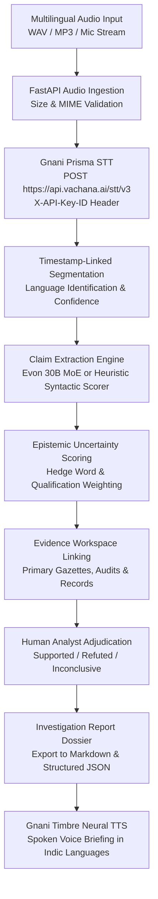
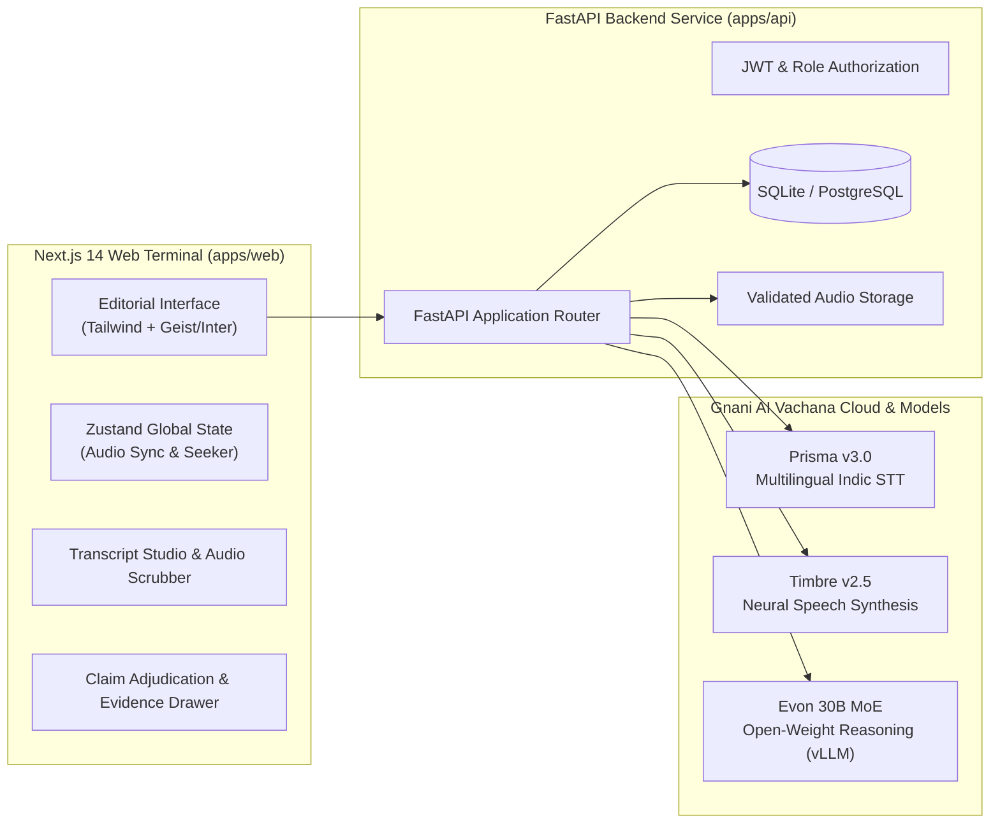
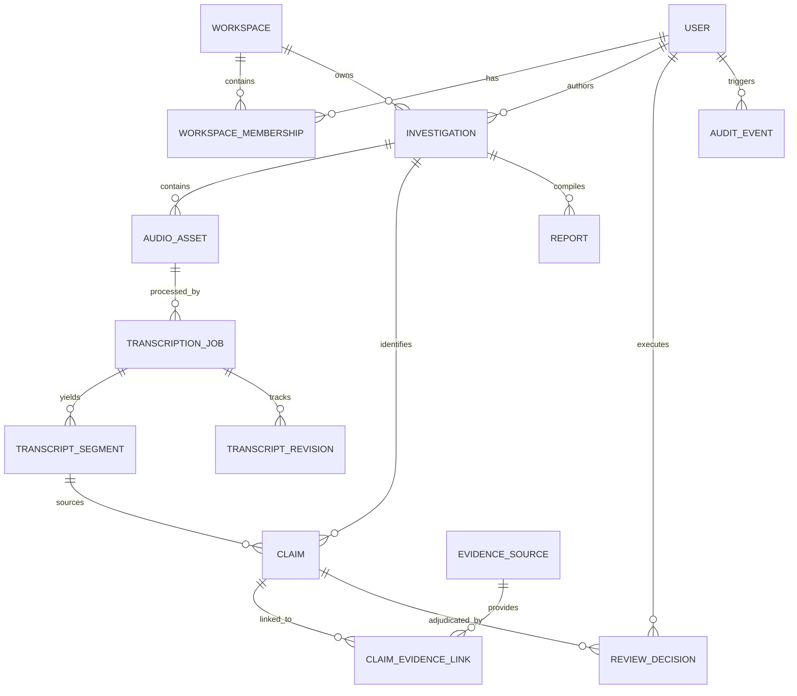

# RAVEN Architecture & System Design

**RAVEN** (Responsible Audio Verification & Evidence Navigator) is a specialized voice intelligence and evidence investigation platform designed for researchers, civic auditors, and investigative journalists.

---

## 1. End-to-End Pipeline Architecture

---

## 2. Component & Network Topology

---

## 3. Database Entity Relationship Diagram

---

## 4. Key Design Tenets

1. **Epistemic Honesty:** A claim is **never** declared true or false automatically by an AI model. Spoken claims require corroboration against verified primary public records (court judgments, gazettes, certified laboratory tests).
2. **Audio-Text Synchronization:** Selecting any transcript segment instantly scrubs the persistent audio player to that exact millisecond offset.
3. **Transparent Fallbacks:** When the live Gnani API key is not configured, the system gracefully runs in high-fidelity demo mode with clear badges (`is_demo_fallback=True`), preventing broken experiences while never deceiving the user about live API invocation.
4. **Editorial Intelligence UX:** Styled with a restrained palette (`#101B2B` Midnight Navy, `#F6F5F1` Warm Off-White, `#242C35` Graphite, `#2A8C85` Muted Teal, and `#C89448` Restrained Amber) with zero generic gradient decoration.
