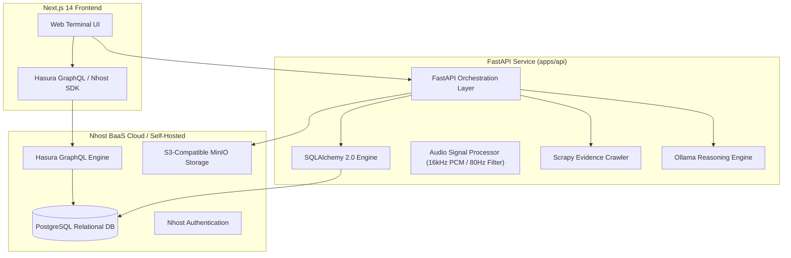

# Backend Platform Architecture Evaluation: Nhost vs. Appwrite

**Project:** RAVEN (Responsible Audio Verification & Evidence Navigator)  
**Evaluation Target:** Selection of BaaS / Persistence Architecture for Multilingual Evidence Intelligence  
**Author:** Principal Software Architect & Full-Stack Systems Lead  

---

## 1. Executive Summary & Decision

| Metric / Dimension | **Nhost** | **Appwrite** |
| :--- | :--- | :--- |
| **Core Database Engine** | Native **PostgreSQL** (Relational) | Document / NoSQL-style Collections |
| **Compatibility with Existing Models** | **100% Drop-in** (SQLAlchemy 2.0, Foreign Keys, Complex Joins, Indexes) | Requires complete schema refactoring (denormalization of relational constraints) |
| **Data Query Layer** | Instant **Hasura GraphQL** + Direct Postgres Connection String | Appwrite REST SDK & Query Filters |
| **Object Storage** | S3-Compatible MinIO Storage | Appwrite Custom Storage Bucket |
| **Auth & Multi-Tenant RBAC** | Postgres-native Row-Level Security (RLS) & Hasura Permission Rules | Appwrite Teams & Document-level Permissions |
| **Self-Hosting / Standalone Mode** | Can run natively or connect to any existing PostgreSQL | Requires Docker Compose stack with Redis, MariaDB/PostgreSQL, Appwrite engine |

### Selected Architecture: **Nhost (PostgreSQL + S3 Storage + Hasura GraphQL)**

**Architectural Rationale:**
1. **Preservation of Existing Relational Schema:** RAVEN relies heavily on deep relational joins:
   $$\text{AudioAsset} \rightarrow \text{TranscriptionJob} \rightarrow \text{TranscriptSegment} \leftrightarrow \text{Claim} \leftrightarrow \text{ClaimEvidenceLink} \leftrightarrow \text{EvidenceSource} \rightarrow \text{ReviewDecision}$$
   Nhost uses standard PostgreSQL under the hood. Our existing SQLAlchemy models (`User`, `Workspace`, `Investigation`, `AudioAsset`, `TranscriptSegment`, `Claim`, `EvidenceSource`, `ReviewDecision`, `Report`, `AuditEvent`) run natively against Nhost's PostgreSQL instance with zero data loss or impedance mismatch.
2. **Hasura GraphQL Engine:** Nhost automatically generates typed GraphQL queries and mutations over the entire PostgreSQL schema, providing high-efficiency querying for frontend dashboards and deep investigation trees without writing custom N+1 REST endpoints.
3. **S3-Compatible Storage:** Nhost provides an S3-compatible API for audio files, matching our audio pipeline architecture and allowing local development fallback without vendor lock-in.
4. **Appwrite Limitation in this Context:** Appwrite uses a document-oriented database model. Porting RAVEN's strict foreign-key integrity, cascade deletions, and relational evidence links to Appwrite would require denormalizing relational data and writing fragile application-level referential integrity checks.

---

## 2. Nhost Integration Architecture

---

## 3. Configuration & Fallback Mode

To guarantee that RAVEN remains 100% runnable in standalone offline mode (e.g., local SQLite for rapid prototyping) while being fully production-deployable to Nhost:
* In local development, the backend defaults to SQLite (`sqlite:///./raven.db`).
* When `NHOST_SUBDOMAIN` and `NHOST_REGION` (or `DATABASE_URL=postgresql://...`) are supplied, RAVEN automatically connects to Nhost's managed PostgreSQL cluster and S3 storage bucket.
